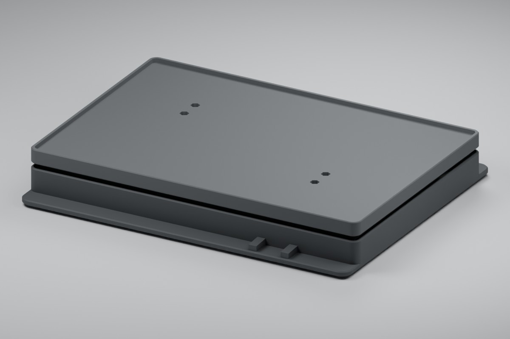

# ESP32 SH02 Filament Scale

[](https://github.com/fabianwimberger/esp32-sovol-sh02-scale/actions/workflows/ci.yml)
[](LICENSE)



Printed weighing plinth for a Sovol SH02 filament dryer. An ESP32-C3 and two HX711 boards report the filament left in the dryer to Home Assistant through ESPHome.

## Background

A filament dryer hides the spools, so the only way to know whether a roll will last for the next print is to open the lid and guess. Weighing the whole dryer answers that without touching it: capture the weight once with full spools inside, and everything that disappears afterwards is filament.

The SH02 holds two rolls and weighs 1.5 kg empty, so it is both wider and top-heavier than a single-spool dryer. The scale is a 251 × 172 mm floating top on a 251 × 200 mm base, built around **two** cheap 5 kg bar load cells that run across the width, one near each end of the length and mirrored so their free ends sit at opposite corners. Their raw counts are added in the firmware, which doubles the capacity to 10 kg, keeps the reading correct for an off-centre load, and carries the top on two seats spread along its length instead of one line across it. The SH02's 246 × 167 mm bottom sits inside the top's rim.

## Features

- **Filament remaining in grams and percent** — counts down from the mass of the spools you loaded
- **Two load cells, summed** — 10 kg working capacity; the cells run across the width, one near each end, so the top is carried along its whole length
- **Calibration from Home Assistant** — three buttons: empty platform, known mass, dryer with full spools; no reflashing
- **Persistent calibration** — zero, gain and spool capture survive reboots and OTA updates; there is no startup tare
- **Stability gate** — a five-second window rejects captures while the reading moves and drops missing, stale or saturated samples
- **Five printed parts, M3 only** — base, top, one ESP32 cap and two HX711 caps; eight M3 × 20 screws clamp the two cells
- **Parametric CAD** — one OpenSCAD file with assertions for every screw length and clearance
- **Diagnostics** — raw counts and per-cell counts, noise range, saved calibration, chip temperature and Wi-Fi signal

## Quick Start

```bash
git clone https://github.com/fabianwimberger/esp32-sovol-sh02-scale.git
cd esp32-sovol-sh02-scale

python -m venv .venv
.venv/bin/pip install esphome

.venv/bin/esphome run firmware/scale.yaml   # first flash over USB
```

Join the **SH02 Scale Setup** access point to enter your Wi-Fi, then add the discovered device in Home Assistant. Later updates go over the air:

```bash
.venv/bin/esphome run firmware/scale.yaml --device sh02-scale.local
```

Print the four files in [`printable/`](printable/) and follow the [Build Guide](docs/build.md) for parts, wiring, assembly and calibration. The [Design Notes](docs/design.md) cover load path, clearances and limits.

Building a second scale for a second dryer needs its own node name: copy `firmware/scale.yaml` and set `device_name` and `friendly_name`.

To change the CAD:

```bash
make meshes   # export printable/*.stl from cad/scale.scad
make images   # re-render docs/ (OpenSCAD and Blender)
make check    # host tests, mesh checks, ESPHome config validation
```

## How It Works

```
dryer + spools ─► floating top ─► two 5 kg cells ─► two HX711 ─► ESP32-C3 ─► Home Assistant
                  (touches nothing   (fixed ends on the base,   counts     5 s window   ESPHome API
                   but the cells)     free ends on the top)     summed

filament remaining = gross mass − (dryer + empty spools)
```

Each cell is a cantilever: its cable end is clamped to a pedestal in the base, its free end to the top. Nothing else connects the base and the top, so every gram on the top passes through the cells, and the two counts add up to the whole load. The cells run across the width, one near each end of the length, and are mirrored so their free ends sit at opposite corners: the top is carried on two seats 130 mm apart along its length, so it barely cantilevers.

Calibration stores three values. **1 Capture empty platform** saves the zero, **2 Capture calibration mass** the counts per gram of the summed reading, and **3 Capture dryer with full spools** subtracts **Full filament mass** from the reading and saves the rest as dryer plus empty spools. Repeat step 3 for every new set of spools, because empty spools differ in weight.

Weight estimates use the median of the latest 25 samples to suppress brief filament pulls. Sustained load changes reach the estimate after about 2.6 seconds at the normal sample rate, then publish on the next five-second update. Zero and reference-mass captures still use the unfiltered average, and noise and stability diagnostics retain every sample. Updating this filter requires no recalibration and preserves the saved calibration and spool tare through a normal OTA update.

The design target is ±10 g. Cable tension, filament pull during a print, heat and plastic creep all shift the reading, so treat it as a trend while printing.

## Configuration

Substitutions at the top of `firmware/scale.yaml`:

| Variable | Default | Description |
|---|---|---|
| `device_name` | `sh02-scale` | ESPHome node name / hostname; unique per scale |
| `friendly_name` | `SH02 Scale` | Display name in Home Assistant |
| `dout_pin_a`, `clock_pin_a` | `GPIO4`, `GPIO3` | HX711 of cell A |
| `dout_pin_b`, `clock_pin_b` | `GPIO6`, `GPIO5` | HX711 of cell B |

The config ships without API encryption or an OTA password; add both before using it on a shared network.

Settings in Home Assistant:

| Entity | Default | Description |
|---|---|---|
| Full filament mass | 2000 g | Filament on the spools when step 3 is pressed (two rolls) |
| Calibration mass | 1000 g | Mass of the reference object used in step 2 |
| Calibration noise limit | 1000 counts | Largest raw range over five seconds that steps 1 and 2 accept |

Parameters at the top of `cad/scale.scad` adapt the print to other hardware:

| Variable | Default | Description |
|---|---|---|
| `platform_length`, `platform_width` | `251`, `172` | Top; the rim leaves 246 × 167 mm for the dryer's bottom |
| `base_width` | `200` | Footing; wider than the top resists tipping |
| `cell_pitch` | `65` | Distance of each load cell from the centreline along the length (65 → 130 mm apart) |
| `cell_hole_spacing`, `cell_hole_end` | `15`, `5` | Hole pattern of the 80 × 12.7 × 12.7 mm cell |
| `fixed_side` | `-1` | End of the cells that is clamped to the base |
| `esp32_pcb`, `hx711_pcb` | measured | Board sizes the pockets are cut for |
| `esp32_wire_zone` | `[3.6,14.4]` | Where the ESP32 cap is notched for wires, from the USB edge |

## License

MIT — see [LICENSE](LICENSE).
